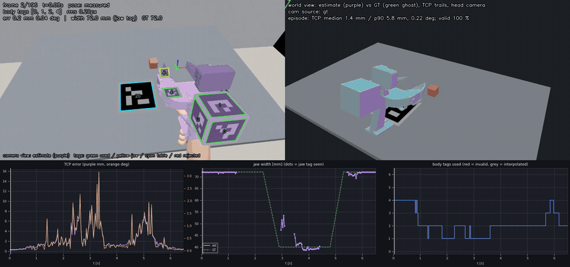
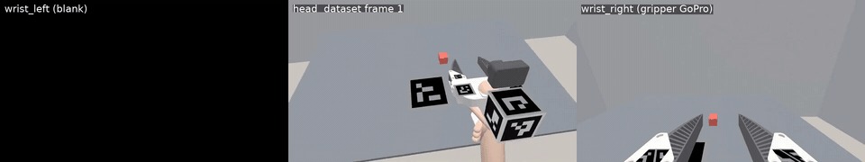
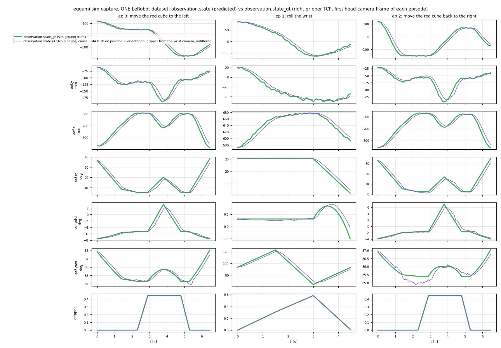

# EgoUMI: UMI pinch gripper + ArUco head-camera tracking

**The gripper design is adapted from Stanford's [Universal Manipulation Interface (UMI)](https://umi-gripper.github.io/)**
(Chi et al., RSS 2024): its CAD, mechanism and soft fingers are kept, the trigger is replaced by a thumb + index
pinch, and the side mirrors are removed to make room for ArUco markers.

> 🚧 **Work in progress.** The hardware is designed but not yet printed or fit-tested. The gripper tracking has been
> tested **only in simulation**; the capture → LeRobot pipeline has also run on real 3-camera footage, without
> gripper poses. Expect breaking changes.

A non-powered, UMI-style handheld gripper that you close with a thumb + index pinch, tracked with ArUco markers
from an egocentric **head** camera, so that human demonstrations can become robot-learning datasets.

It builds on my [**h2r_collection**](https://github.com/ravikola02/h2r_collection) pipeline (egocentric head video →
HaWoR hand pose + head SLAM → LeRobot dataset). The goal is a `--source gripper` mode there that replaces the
HaWoR hand pose with the gripper pose from the markers and keeps HaWoR's head-camera SLAM
([plan](docs/h2r_gripper_plan.md)).

[](assets/preview_pick_place.mp4)

*Simulated pick-and-place ([mp4](assets/preview_pick_place.mp4)). **Left, RECORDING:** what the egocentric head
camera sees. **Right, RECONSTRUCTION:** the gripper pose recovered from the ArUco markers (purple, with its TCP path)
against ground truth (green), and the head camera moving through the scene (orange, with its path). Bottom: TCP
error, jaw width, and the number of body tags in view. Made with `scripts/preview_gripper.py --style presentation`;
the default `--style debug` overlays the estimate on the frame with per-tag detail
([wrist-roll episode, debug style](assets/preview_roll.mp4)).*

## What's here
| Part | Status |
|---|---|
| `cad/`: gripper derived from the [Stanford UMI](https://umi-gripper.github.io/) CAD; pistol grip kept, trigger replaced by a thumb ring and an index ring on the finger holders; mirrors removed to make room for tags | CAD done and collision-checked, print files for a Bambu H2D in `cad/out_v3` ([print notes](docs/PRINT_NOTES.md)); **not printed yet** |
| `sim/`: synthetic head-camera episodes (textured CAD, ArUco stickers, hand stand-in, wood-grain table, object, head bob, tremor, blur, noise) in HaWoR's frame layout, with ground truth | working |
| `umi_pipe/` + `scripts/gripper_pose.py`: subpixel ArUco → multi-tag PnP (SQPNP + LM, outlier rejection, single-tag disambiguation) → joint body + jaw refinement → jaw width → world TCP pose | working in sim |
| `scripts/preview_gripper.py`: the preview above, the gripper counterpart of HaWoR's MANO cam/world visualisation; also runs on real sequences without ground truth | working |
| `collection/`: 3-camera capture (head + 2 gripper/wrist cams) → audio sync → browser tagger → frame-exact clips → LeRobot v3.0 / v2.1, the h2r_collection flow without HaWoR ([details](collection/README.md)) | working: tested on the h2r_collection Sample session and on a rendered capture |
| Trajectories in the dataset: `--state-source aruco` reconstructs the gripper TCP from the head clips (14-d h2r_collection layout); with sim ground truth the same dataset also gets `observation.state_gt` / `action_gt` | working in sim: gripper value from the gripper (wrist) camera on 100 % of frames; causal EMA α 0.18 on the predicted pose, position and orientation (chosen by the h2r delta-noise criterion, `sim/ema_sweep.py`); head-camera motion still comes from the sim (SLAM not wired) |
| `sim/render_capture.py`: rendered raw capture (head camera, gripper GoPro, blank second wrist feed, skewed clocks, clap soundtrack) + `sim/check_capture_sync.py` (sync and cut accuracy against ground truth) | working |
| HaWoR SLAM for head-camera motion, camera calibration, real captures | planned |

## Quick start: capture → LeRobot dataset
```bash
python3 collection/run_pipeline.py --session <session>   # data/raw/<session>/{top_cam,left_w_cam,right_w_cam}/
```
See [collection/README.md](collection/README.md).

[](assets/dataset_sim_capture.mp4)

*A LeRobot v3.0 dataset made by the pipeline from a rendered capture ([mp4](assets/dataset_sim_capture.mp4)): blank
left wrist feed | head camera | GoPro on the gripper. The three recordings started at different times with skewed
clocks; the audio sync recovered the offsets exactly and every cut is frame-exact against ground truth.*



*The same dataset's trajectory columns: `observation.state` reconstructed by the ArUco pipeline (purple) against
the raw `observation.state_gt` (green). Right gripper TCP in each episode's first head-camera frame; the head-camera
motion here comes from the sim. The gripper value comes from the wrist camera (within about 1 mm of jaw width). The
pose carries a causal EMA (α 0.18 on position and on orientation, 152 ms lag), which brings the one-step delta noise to the G1 robot's level;
the lag is what separates the purple and green position curves (`--ema-pos 1` turns it off).*

## Quick start (simulation)
Runs in a Python env with `pyrender`, `trimesh`, `opencv-python` (≥ 4.7, ArUco), `scipy`, `pyyaml` and
`matplotlib` (the HaWoR env from h2r_collection has all of them), with headless EGL rendering and `ffmpeg`.
```bash
sim/run_sim_test.sh pick_place                                            # render -> pose -> preview
MARKERS=configs/gripper_markers_jawflags.yaml sim/run_sim_test.sh pick_place_jawflags
sim/run_sim_test.sh roll --preset roll --seed 1
sim/run_sim_test.sh blur_table --blur 5 -- --cam-source table              # args after -- go to gripper_pose.py
# output: sim/episodes/<name>/preview/{gripper_preview.mp4,metrics.json,timeline.png}
```
Set `PY=/path/to/python` if your interpreter is not the HaWoR conda env. `sim/assets/meshes` is checked in;
`sim/export_meshes.py` regenerates it from the STEP file (needs CadQuery).

## Sim results
Egocentric head camera (behind and above the user's hands); gripper and markers as in the CAD.

| Episode | TCP error median / p90 / max | Jaw width seen by the head camera |
|---|---|---|
| pick-and-place | 1.7 / 6.1 / 16.2 mm | 21 % of frames (width error median 0.00, max 0.44 mm) |
| wrist roll | 0.60 / 0.98 / 1.8 mm | 73 % (median 0.21, max 0.94 mm) |

Jaw width comes from the **gripper (wrist) camera**, as in UMI. In the render it sits at the GoPro lens, pitched
down 15° so both jaw tags stay in its pinhole frame over the full travel; it sees both tags at every travel.

What the sim showed so far (details in [sim/README.md](sim/README.md)):
- From the head camera the GoPro and the cube often block the holder-top jaw tags; the wrist camera always sees
  them. An earlier claim here, that they were never visible, came from two renderer bugs (sheared jaw-tag
  textures; stickers lit only by ambient light), both fixed.
- Frames where only one body tag is visible cause most of the head-camera pose error: the TCP is about 29 cm from
  the cube tags.
- Camera motion has to come from SLAM. There is no table marker: like h2r_collection, the world frame is each
  episode's first head-camera frame, so nothing needs one (an optional table tag could later check SLAM scale/drift).

Not modelled yet: lens distortion, rolling shutter, glare, real SLAM drift. The TCP point is an estimate from the CAD.

## Layout
```
cad/            CadQuery build scripts (v1 → v3), Stanford UMI input STEP, v3 print files, renders
collection/     capture → LeRobot pipeline (sync, tagger, converter)
configs/        marker layouts (body frame = CAD assembly frame, metres), sim camera
docs/           pipeline plan for h2r_collection, print notes
sim/            episode + raw-capture renderers, sync/cut checker, mesh export, one-command test runner
umi_pipe/       shared model / rendering / pose-estimation code
scripts/        gripper_pose.py (pipeline), preview_gripper.py (preview)
assets/         README media
```

## Credits and licence
- Gripper mechanism and base CAD: [Universal Manipulation Interface](https://umi-gripper.github.io/) (Chi et al.,
  Stanford). The files in `cad/input/` are their design exported from Onshape; their terms apply to that design.
- Data pipeline: [h2r_collection](https://github.com/ravikola02/h2r_collection); `collection/` vendors its sync,
  tagger and dataset writers. h2r_collection uses
  [HaWoR](https://github.com/ThunderVVV/HaWoR) (CC BY-NC-ND).
- The code in this repository is MIT licensed (see `LICENSE`).
