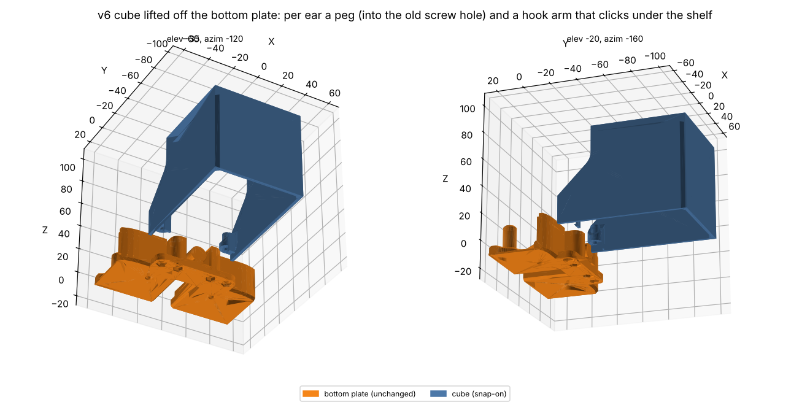
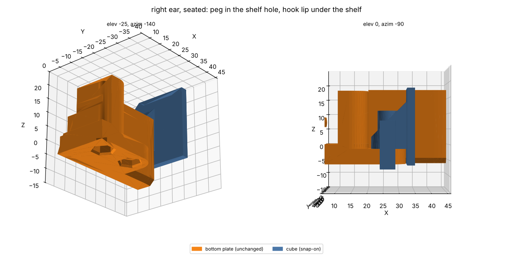
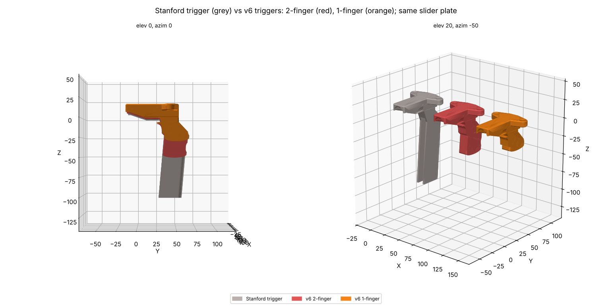

# v6: one TPU finger for both grippers, fit-on jaw tag cap, snap-on marker cube

Status: CAD, fit- and collision-checked, **not printed yet**. Build: `cd cad && ../.venv-cad/bin/python build_v6.py`.

The finger joint is Akshat's drop-in fit, copied from the files he sent (`UMI_Claw_Print.stl`,
`PLA_Rigid_Mount_Reinforced.stl`; not in the repo). His claw's base is a tenon with two dovetail sockets on its outer
edge; his mount has a back slab and a wall with two matching dovetail tabs. The claw drops in from above and the
tabs lock it forward, back and sideways. The outlines in `build_v6.py` (`AK_TENON`, `AK_WALL`, `AK_SLOT`) are his,
measured from the STLs.

## Parts (per side, left and right are mirror images)
- **Common TPU finger**: the UMI fin-ray blade from the holder's front forward, a 2 mm solid flange at its base, and
  Akshat's tenon: same outline, 24 mm tall, inset 0.9 mm top and bottom of the 25.8 mm blade, with his 2.5 x 10 mm
  slot for his mount's cross pin. Tip, inner face and height are the UMI finger's; the envelope (37 x 119.9 x 25.8)
  is his claw's. It fits his mount where his claw goes and our holder where the UMI finger went.

   
- **Holder**: the Stanford holder with its top plate cut off over the finger (from y 76 forward), the bolt holes and
  nut pockets filled, Akshat's back slab and tabbed wall built between the plates, a floor under the tenon at his
  height (0.9 mm above the blade's underside), and the v5 dovetail rail underneath. All ring mounts fit unchanged.
- **Tag cap**: the cut-off piece of top plate. It replaces the cross pin of Akshat's mount: its tongue goes into a slot
  in the holder's top plate, the cap swings down, and a snap arm on its outer edge clicks under the bottom plate. A
  pad under it squeezes the tenon by 0.1 mm so nothing rattles.
  - The jaw tag sits in a 20.4 mm, 0.2 mm deep recess; the cap's top is 0.2 mm higher than the holder, so a 0.2 mm
    sticker's face lands where `configs/gripper_markers.yaml` already puts tags 6 and 7. No config change.
  - Release: push the snap arm's tip outward from below, swing the cap up, pull it forward, lift the finger out.

The finger sits centred in the 26.2 mm gap, 0.2 mm lower than the v3 CAD finger. The right side is an exact mirror of
the left, so its finger sits 0.57 mm further out than the Stanford one (finger gap at 36 mm travel per side: 8.0 mm,
stock v3 fingers 7.4 mm in the same CAD).

## Marker cube: snap-on instead of screws (`cad/build_cube_v6.py`)

The cube was held by two M3 screws through its ears into nut pockets in the bottom plate's shelf. Only the cube
changes; the bottom plate is the printed Stanford one. Per ear:
- a solid 3.4 mm peg drops into the shelf's old 3.6 mm screw hole: it locates the cube front-back and sideways,
  together with the ears' inner faces against the plate's tabs (as before);
- a 5 mm wide, 1.6 mm thick hook arm hangs down just behind the shelf's rounded back edge, and its lip clicks under
  the shelf, so the cube can't lift. The arm is 14 mm long (1.8 % bending strain when it flexes 1.5 mm to pass the
  shelf), and its catch face is flat.
- Release: push the two arm tips backwards from under the cube (it is open underneath) and lift.
- Print the cube rear face down, as the v3 cube: the arms lie flat, with layers along their length.

A snap pin through the screw hole was tried first and dropped: the hole has a 45° chamfer (r 1.8 to 2.4) above the
nut pocket, so barbs small enough to pass the 3.6 mm hole never catch anything.

The cube carries the four main tracking markers and is held only at its front, so play tilts them: 0.1 mm of lift at
the ears moves the rear marker about 1 mm. In CAD the hook lips touch the shelf's underside with no gap; whether the
printed snap holds the cube as solidly as the screws did is untested.

## Trigger: shorter and solid (`cad/build_trigger_v6.py`)

An alternative to the ring mounts. The Stanford trigger's stem hangs ~100 mm below the slider and the fingers pull it
backwards along most of that length (centre ~z −55). That lever twists the slider: its rear end lifts into the lid
and the front presses on the bottom plate, and the bending peaks at the stem's root. The push on the lid is roughly
finger force × lever / slider length, about as large as the finger pull.

The v6 trigger keeps the slider plate as it is and replaces the stem:
- only as long as the fingers that pull it, with finger scallops near the top: **2-finger** (stem to z −50, lever
  33 mm) or **1-finger** (stem to z −30, lever 22 mm), against ~60 mm for the Stanford trigger. Estimated push on
  the lid: about 54 % and 37 % of the original;
- a solid stem section all the way down (the original is an I/T section below its root), with 6 mm fillets where it
  meets the slider plate (root section 335 mm², was 293), within the original 13 mm width;
- printed lying on its side, so the layers run along the stem.
Both clear the grip, bottom plate, v4 cover and cube over 16 mm of slider travel. Print: `tmp_print/UMI_v6_triggers_PLA.3mf`.

Not verified: the lid-push numbers are lever-arm estimates, not measurements; where the old trigger actually broke
is not known, so the stronger root is a guess at the weak point; whether one finger can pull the spring is untested.

The v4 top cover with the Osmo Nano hat-clip bracket (`cad/build_v4.py`, the printed action-cam cover) is now the
top cover of the v6 assembly. No new collisions with any v6 part.

## Checks (in CAD)
- Our tenon outline is identical to Akshat's (0.00 mm² difference) and our wall differs by 0.45 mm² (rounding).
- Every part is a single valid solid. The finger collides with the holder or cap if moved 0.5 mm in any direction;
  the cap collides with the holder if moved down, back, sideways or up.
- Seated: cap and holder don't overlap; the pad squeezes the tenon as intended. The finger overlaps the holder by
  12 mm³: one face of each of Akshat's tabs sits 0.03–0.19 mm inside the socket (his claw overlaps his mount the same
  way), the opposite face has about 0.3 mm play. Kept as he designed it.
- No collisions over the jaw travel; all eight ring mounts seat, lock and travel clear on the new holders.
- Cube: no overlap with the bottom plate when seated; it collides with the plate if moved 0.3 mm in any direction
  (lift is stopped by the hook lips). The cube and the v4 cover add no collisions beyond those the Stanford assembly
  already has; nothing under the shelf is in the arms' way.

## Print (git-ignored `tmp_print/`)
- `UMI_v6_holders_caps_PLA.3mf`: 2 holders + 2 caps, PLA+ (holders top-down with tree supports, as in v3).
- `UMI_v6_fingers_TPU.3mf`: 2 common fingers, TPU 95A, flat, 100 % line infill (Stanford's TPU finger settings).
- `UMI_v6_cube_PLA.3mf`: the snap-on cube, PLA, rear face down.
- STEP / STL for all parts in `cad/out_v6/` (plus `top_cover_v4.step`).

## Not verified
- The fits: Akshat's zero-clearance dovetail in TPU against PLA, the tongue (0.15 mm), the 1.3 mm snap lip and the
  0.1 mm pad squeeze. Print one holder, one cap and one finger first.
- A TPU tenon holds less firmly than his PLA one against pull-out along the finger; the cap holds it down, but heavy
  pulls are untested.
- The fit in his mount is checked by matching outlines and heights to his files (his floor and cross-pin hole were
  read off his STL), not by a print.
- How solidly the snap-on cube sits compared with the screws (see above).
- The trigger estimates and failure point (see above).
- The 3MFs have not been opened in Bambu Studio. `sim/assets/meshes` still holds the v3 holders and fingers.
