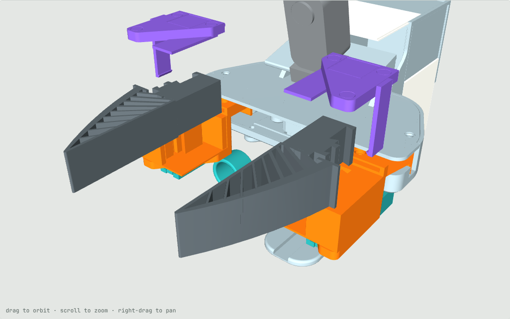
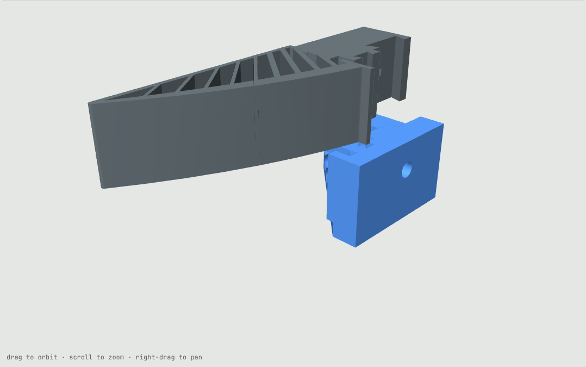
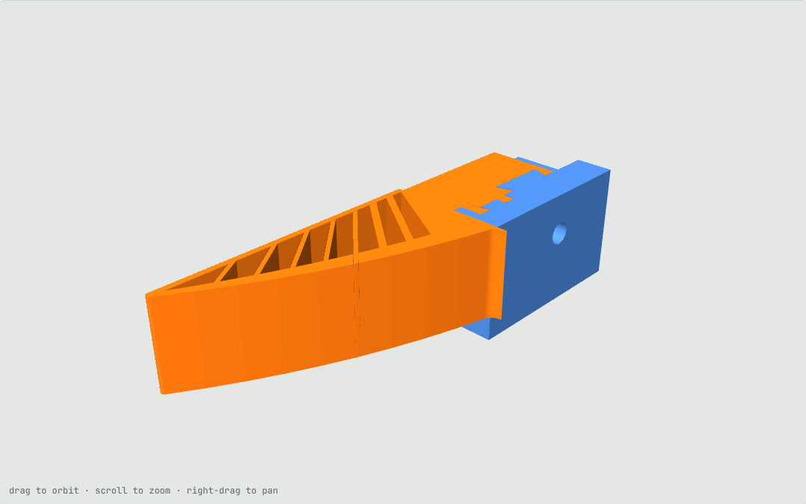
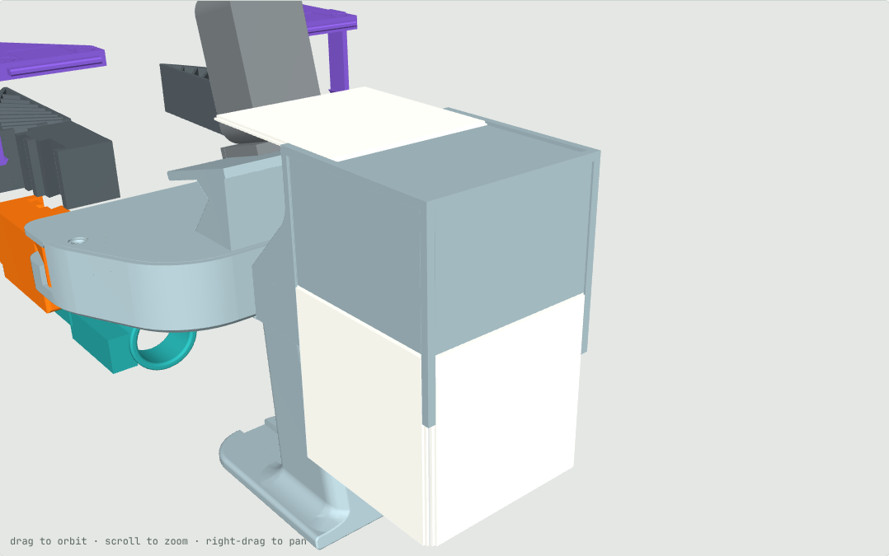

# v6: one TPU finger for both grippers, screwless, fit-on jaw tag cap, slide-in cube marker tiles

Status: CAD, fit- and collision-checked, **not printed yet**. Build: `cd cad && ../.venv-cad/bin/python build_v6.py`.

The finger joint is Akshat's drop-in fit, copied from the files he sent (`UMI_Claw_Print.stl`,
`PLA_Rigid_Mount_Reinforced.stl`; not in the repo). His claw's base is a tenon with two dovetail sockets on its outer
edge; his mount has a back slab and a wall with two matching dovetail tabs. The claw drops in from above and the
tabs lock it forward, back and sideways. The outlines in `build_v6.py` (`AK_TENON`, `AK_WALL`, `AK_SLOT`) are his,
measured from the STLs.

## Parts (per side, left and right are mirror images)
- **Common TPU finger**: the UMI fin-ray blade from the holder's front forward, a 2 mm solid flange at its base, and
  Akshat's tenon: same outline, 24 mm tall, inset 0.9 mm top and bottom of the 25.8 mm blade, with his 2.5 x 10 mm
  slot for his mount's cross pin. Tip, inner face and height are the UMI finger's; the envelope (37 x 119.9 x 25.8)
  is his claw's. It fits his mount where his claw goes and our holder where the UMI finger went.

   
- **Holder**: the Stanford holder with its top plate cut off over the finger (from y 76 forward), the bolt holes and
  nut pockets filled, Akshat's back slab and tabbed wall built between the plates, a floor under the tenon at his
  height (0.9 mm above the blade's underside), and the v5 dovetail rail underneath. All ring mounts fit unchanged.
- **Tag cap**: the cut-off piece of top plate. It replaces the cross pin of Akshat's mount: its tongue goes into a slot
  in the holder's top plate, the cap swings down, and a snap arm on its outer edge clicks under the bottom plate. A
  pad under it squeezes the tenon by 0.1 mm so nothing rattles.
  - The jaw tag sits in a 20.4 mm, 0.2 mm deep recess; the cap's top is 0.2 mm higher than the holder, so a 0.2 mm
    sticker's face lands where `configs/gripper_markers.yaml` already puts tags 6 and 7. No config change.
  - Release: push the snap arm's tip outward from below, swing the cap up, pull it forward, lift the finger out.

The finger sits centred in the 26.2 mm gap, 0.2 mm lower than the v3 CAD finger. The right side is an exact mirror of
the left, so its finger sits 0.57 mm further out than the Stanford one (finger gap at 36 mm travel per side: 8.0 mm,
stock v3 fingers 7.4 mm in the same CAD).

## Marker cube: slide-in tiles (`cad/build_cube_v6.py`)

The four 60 mm cube markers (IDs 0-3) go on printed tiles instead of straight onto the cube.
- Each face has a pocket with undercut grooves along two edges. The rear and side tiles slide up from the cube's open
  bottom, the top tile slides back from the top wall's front edge; each stops at the closed end and a 0.4 mm bump on
  its back clicks into a hole in the pocket floor. A 1.6 mm backing plate inside each wall keeps the floor 2.4 mm.
- The tile face is flush with the old cube face, so marker centres, normals and up in
  `configs/gripper_markers.yaml` are unchanged.
- Every face is exactly 70 mm across, so the tiles are 64 mm (rim, and clear of each other at the corners): the
  stickers are cut to 64 mm, a 2 mm white margin instead of 5 mm. The config margins for IDs 0-3 are now 0.002 and
  `assets/print/egoumi_aruco_markers.pdf` is regenerated. Print the cube and tiles in a light colour so the 3 mm rim
  adds to the white border.
- Swap a tile: push the bump out from inside the cube (open underneath) and slide the tile out.
- The cube still bolts to the bottom plate with its two M3 screws.
- Print: cube open side down with tree supports under the top wall (removable through the open bottom); face-down
  would leave a 64 mm pocket floor bridging over air. Tiles print sticker face down.

## Top cover
The v4 top cover with the Osmo Nano hat-clip bracket (`cad/build_v4.py`, the printed action-cam cover) is now the
top cover of the v6 assembly. No new collisions with any v6 part.

## Checks (in CAD)
- Our tenon outline is identical to Akshat's (0.00 mm² difference) and our wall differs by 0.45 mm² (rounding).
- Every part is a single valid solid. The finger collides with the holder or cap if moved 0.5 mm in any direction;
  the cap collides with the holder if moved down, back, sideways or up.
- Seated: cap and holder don't overlap; the pad squeezes the tenon as intended. The finger overlaps the holder by
  12 mm³: one face of each of Akshat's tabs sits 0.03–0.19 mm inside the socket (his claw overlaps his mount the same
  way), the opposite face has about 0.3 mm play. Kept as he designed it.
- No collisions over the jaw travel; all eight ring mounts seat, lock and travel clear on the new holders.
- Cube tiles: no overlap when seated or with each other; each is held outward, sideways and toward its stop by the
  grooves and pocket, and toward the entry by the detent. Cube, tiles and the v4 cover add no collisions beyond those
  the Stanford assembly already has.

## Print (git-ignored `tmp_print/`)
- `UMI_v6_holders_caps_PLA.3mf`: 2 holders + 2 caps, PLA+ (holders top-down with tree supports, as in v3).
- `UMI_v6_fingers_TPU.3mf`: 2 common fingers, TPU 95A, flat, 100 % line infill (Stanford's TPU finger settings).
- `UMI_v6_cube_tiles_PLA.3mf`: the cube and 4 marker tiles, PLA (light colour).
- STEP / STL for all parts in `cad/out_v6/` (plus `top_cover_v4.step`).

## Not verified
- The fits: Akshat's zero-clearance dovetail in TPU against PLA, the tongue (0.15 mm), the 1.3 mm snap lip and the
  0.1 mm pad squeeze. Print one holder, one cap and one finger first.
- A TPU tenon holds less firmly than his PLA one against pull-out along the finger; the cap holds it down, but heavy
  pulls are untested.
- The fit in his mount is checked by matching outlines and heights to his files (his floor and cross-pin hole were
  read off his STL), not by a print.
- Marker detection with the 2 mm sticker margin (plus the cube rim); the tile slide, detent and groove clearances.
- The 3MFs have not been opened in Bambu Studio. `sim/assets/meshes` still holds the v3 holders and fingers.
