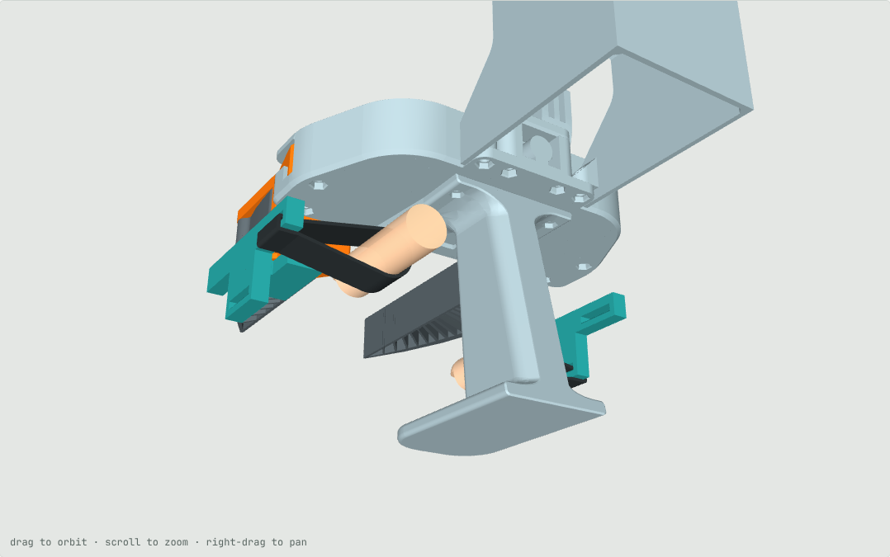
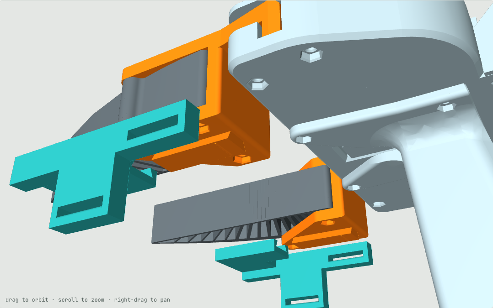
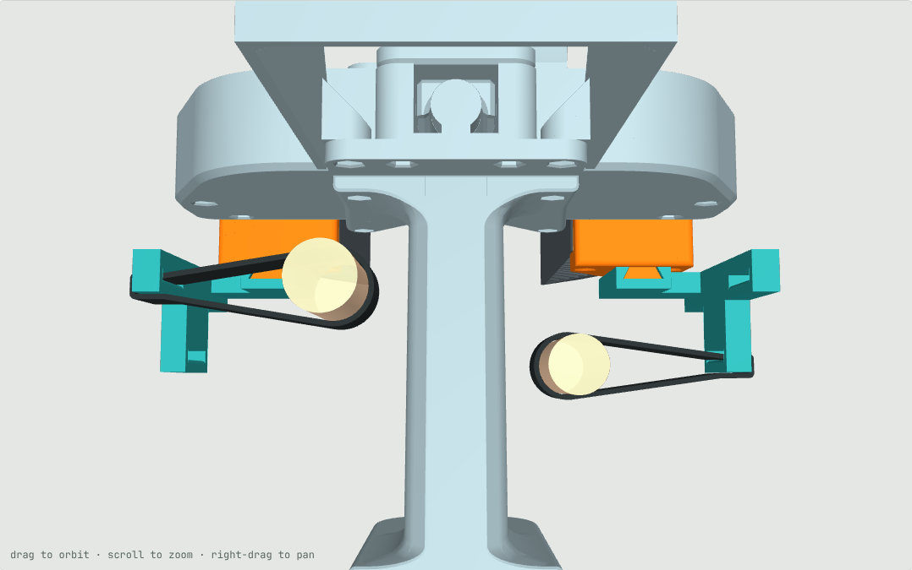
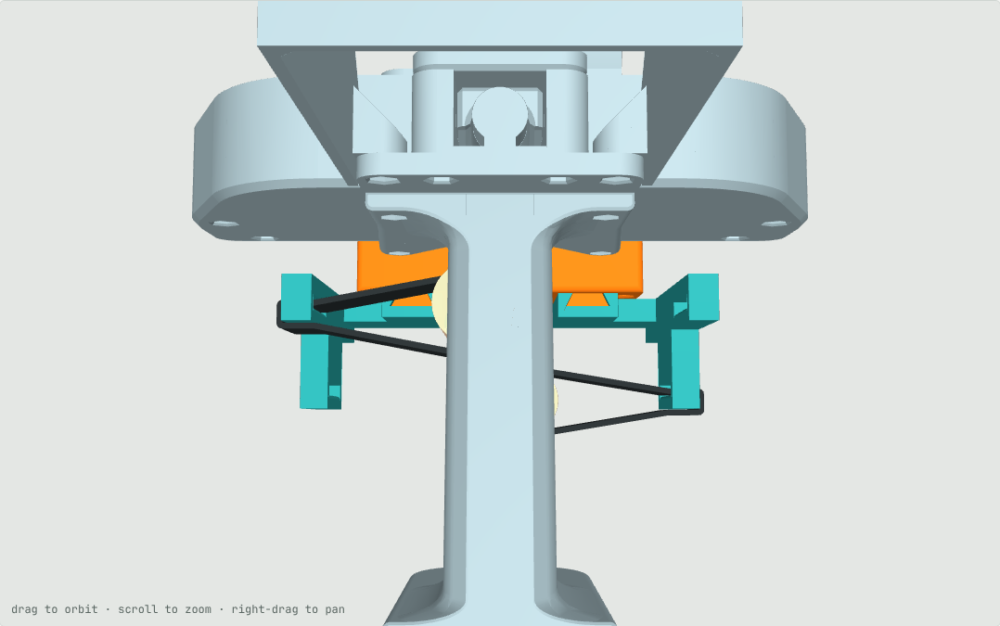

# v5 wearables: slide-on strap mounts instead of finger rings

Status: CAD concept, collision-checked, **not printed or worn yet**. Build: `cd cad && ../.venv-cad/bin/python build_v5.py`.

## Problem
In v3 the thumb ring and the index ring are 90 mm apart with the jaws open, at fixed positions with fixed bores
(22 / 20 mm), fused to the holders, and the two holders differ, so the gripper is right-handed. The spacing is too
wide for smaller hands.

## Design
- **Holder**: the Stanford finger holder plus a dovetail rail under its lower plate (x 56.5–69.5, y 74–110), where the
  v2 thumb arm was. No ring, no arm. Left and right are mirror images.
- **Strap mount** (one per holder, mirror images): slides onto the rail from the front until its closed end stops on
  the rail, and a 0.3 mm bump clicks into a groove. No screws. Jaw-direction loads go into the dovetail flanks,
  pulling back goes into the stop. Any other wearable (rings, cradles) can be a new part on the same rail.
- The mount carries a fin outside the gripper body (|x| 86–94 with the jaws open) with two strap windows: rear and
  high (y 30–52, z −32, where a thumb reaches) and front and low (y 60–82, z −55, where an index reaches).
- A 20 mm back-to-back hook-and-loop strap goes through a window, around the bar under it, around the finger, and
  closes on itself. Closing only pulls on the strap (thumb pushes inward, index pulls inward, each away from its own
  holder); the spring opens the jaws. Loop length sets where the finger sits, so any hand picks its own open spread,
  and the loop takes any finger size.
- Right hand: thumb in the left mount's rear window, index in the right mount's front window. Left hand: mirrored.
- **Print**: the two finger holders (once) and the two strap mounts, STL / STEP in `cad/out_v5/`. The build also
  writes a Bambu Studio project to `tmp_print/UMI_v5_holders_mounts_PLA.3mf` (git-ignored). Every other v3 part, the marker layout and the jaw tags on the holder tops are
  unchanged.

## Closing fully
Each finger travels the full jaw travel (36 mm per side) wherever its strap is anchored, so a thumb and index at the
same height meet early when the open spread is narrow. Moving the anchors outward does not change that. What does is
the 23 mm height stagger between the two windows (v3: 9.5 mm): the thumb passes over the index, as in a key pinch.

| Open spread thumb–index | Fingertip gap left, staggered (this design) | If the fingers met at the same height |
|---|---|---|
| 100 mm | 0 | 0 |
| 85 mm | 0 | ~9 mm |
| 72 mm | 0 | ~22 mm |

Estimates for straight stand-in fingers (radius 10 / 9 mm). Below 72 mm the thumb would have to cross past the index.

 

## Not verified
- Whether a 23 mm thumb-over-index stagger is a comfortable pose; no fit print yet.
- The dovetail fit (0.15 mm clearance per face, 0.3 mm bump) is printer-dependent: print one mount first and tune
  `CLEAR` / `DETENT` in `build_v5.py`.
- Comfort and control feel of a strap loop (less rigid than a ring). The jaws open only by the spring; a slack strap
  cannot pull a sticking slider open.
- The fins make the gripper 16 mm wider with the jaws open (188 mm).
- Finger sizes and positions are estimates, as in v2. The collision check covers rails, mounts and straps against
  every rigid part over the jaw travel (none found), not a real hand around the grip.
- The 3MF is generated with v3's settings and its meshes are watertight; it was not opened in Bambu Studio.
- `sim/assets/meshes` still holds the v3 holders.
