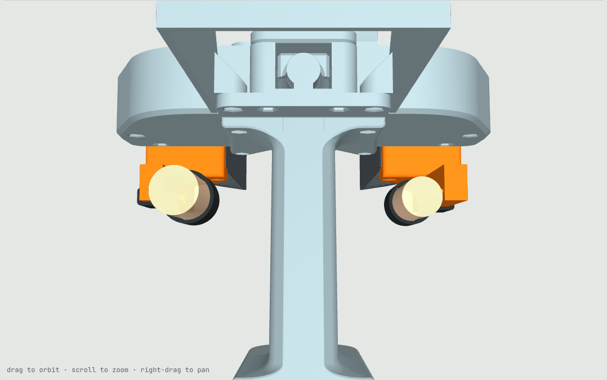
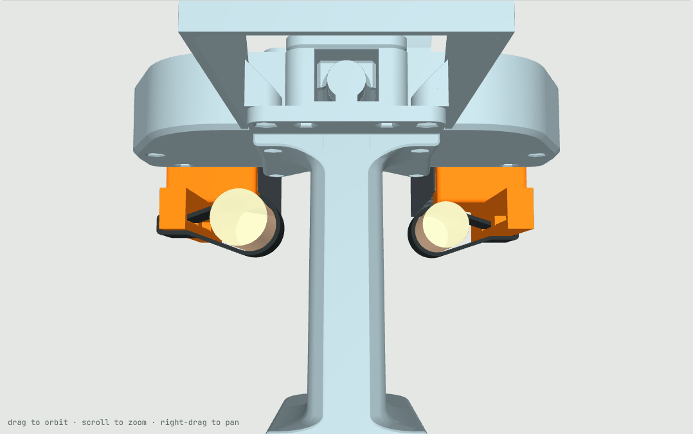

# v5 wearables: strap anchors instead of finger rings

Status: CAD concept, collision-checked, **not printed or worn yet**. Build: `cd cad && ../.venv-cad/bin/python build_v5.py`.

## Problem
In v3 the thumb ring and the index ring are 90 mm apart with the jaws open, at fixed positions with fixed bores
(22 / 20 mm), and the two holders differ, so the gripper is right-handed. The spacing is too wide for smaller hands.

## Design
- Both finger holders get the same rail on their underside (the v2 thumb arm, mirrored onto the other holder) with
  two strap windows: rear (y 30–52, where a thumb reaches) and front (y 60–82, where an index reaches).
- A 20 mm back-to-back hook-and-loop strap goes through a window, around the bar under it, around the finger, and
  closes on itself. Closing only pulls on the strap (thumb pushes inward, index pulls inward, each away from its own
  holder); the spring opens the jaws.
- Loop length sets where the finger sits: a longer loop moves it inward and narrows the open spread. The loop takes
  any finger size and the finger finds its own height and angle.
- Right hand: thumb in the left holder's rear window, index in the right holder's front window. Left hand: mirrored.
- **Reprint only the two finger holders** (`cad/out_v5/UMI_v5_holders_PLA.3mf`, or the STL / STEP files next to it).
  Every other v3 part, the marker layout and the jaw tags on the holder tops are unchanged.

| Loop, per side | Open spread thumb–index | Fingertip gap left when thumb and index meet side by side |
|---|---|---|
| tight | 104 mm | 0 (jaws close fully) |
| +7 mm | 90 mm (= v3) | ~4 mm |
| +14 mm | 76 mm | ~18 mm |
| +21 mm | 62 mm | ~32 mm |

 

## The limit
Each finger still travels the full jaw travel (36 mm per side). Moving both fingers inward by d narrows the open
spread by 2d, and they then meet 2d earlier. The table's last column is an estimate for stand-in fingers (radius
10 / 9 mm) meeting side by side at the same height; a thumb that rides over the index closes further. So a narrow
setting trades away the smallest grasps, and the strap lets each user pick that trade per task.

## Not verified
- Comfort and control feel of a strap loop (less rigid than a ring); no fit print yet.
- The jaws open only by the spring; a slack strap cannot pull a sticking slider open.
- Finger sizes and positions are estimates, as in v2. The collision check covers rails and straps against every
  rigid part over the jaw travel (none found), not a real hand around the grip.
- The 3MF is generated with v3's settings (holders print top face down, tree supports) and its meshes are watertight;
  it was not opened in Bambu Studio.
- `sim/assets/meshes` still holds the v3 holders.
